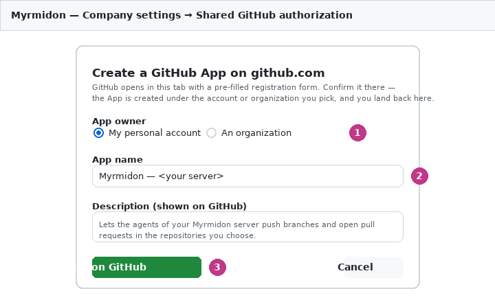
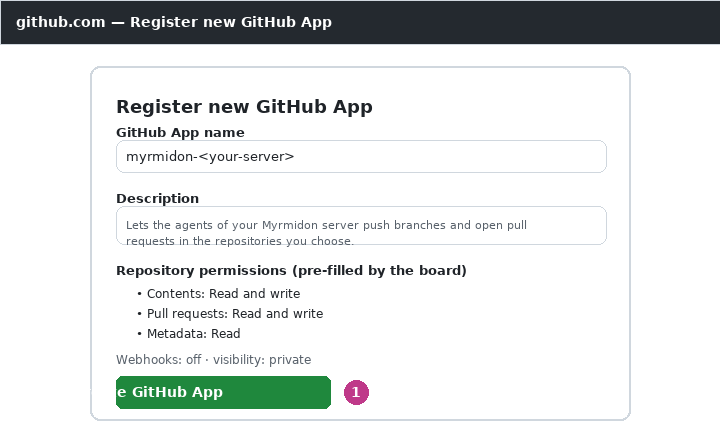
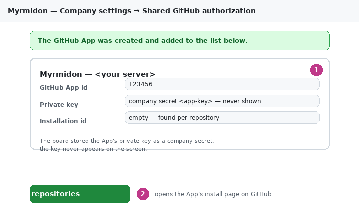
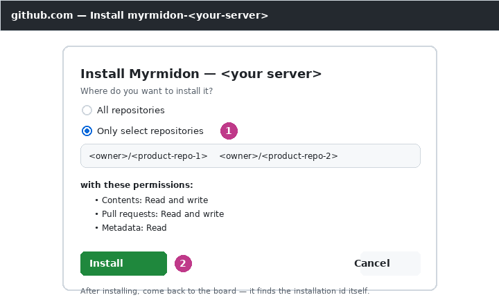

# Авторизоваться в GitHub один раз на весь сервер через своё GitHub App (GITHUB-SHARED-IDENTITY)

> English version: [github-shared-identity.md](github-shared-identity.md)

Агенты разработки пушат код через брокер GitHub, привязанный к прогону
(`POST /runtime-tools/github/credentials`, см. CONTAINER-GITHUB-WRITE в
[SETTINGS.ru.md](../SETTINGS.ru.md)). До сих пор брокер знал только
OAuth-идентичности на человека или на агента, и шли они через облачный
коннектор вендора и GitHub App вендора — третью сторону с правом записи в
репозитории. Эта функция заменяет это **собственными GitHub App**:
приложение регистрируется один раз на аккаунт или организацию, и через него
пушит каждый агент, которого разрешил оператор. Сервисы вендора не
участвуют: доска сама подписывает JWT приложения и сама выпускает токены.

Приложений может быть несколько — например, репозитории одного продукта под
аккаунтом его владельца, а репозитории другого продукта под отдельным
бот-аккаунтом. Брокер выбирает приложение по **целевому репозиторию каждой
операции**, поэтому они никогда не смешиваются.

## Как это работает

- **Регистрация.** Путь в один клик: в настройках компании → **Shared GitHub
  authorization** нажмите **Создать GitHub-приложение**, подтвердите диалог
  (владелец — личный аккаунт или организация, имя приложения `Myrmidon —
  <экземпляр>`, описание), а затем уже заполненную форму, которую откроет
  GitHub. Вы вернётесь на доску, и новое приложение появится в списке само;
  приватный ключ приложения доска уже сохранила секретом компании и нигде не
  показывает. Манифест-поток регистрирует приложение ровно с теми правами,
  которые нужны агентам: **Contents: Read and write, Pull requests: Read and
  write, Metadata: Read**, вебхуки выключены. Ручной путь (GitHub → Settings
  → Developer settings → GitHub Apps → New GitHub App, затем App id и секрет
  ключа в панель) продолжает работать как альтернатива — см. «Ручной путь»
  ниже.
  Созданное по манифесту приложение можно позже расширить на GitHub
  (например, **Workflows: Read and write**, если агенты должны править
  `.github/workflows/*`): право, которое GitHub не выдаёт приложению,
  превращает в ошибку каждую выдачу с ним — поэтому сначала расширяют
  приложение, потом запись.
- **Установка.** У созданного по манифесту приложения в записи есть кнопка
  **Установить на репозитории**: она открывает страницу установки приложения
  на GitHub, где вы выбираете репозитории этого продукта и подтверждаете.
  Возвращаться на доску с id установки не нужно — доска находит его сама по
  репозиторию через `GET /repos/{owner}/{repo}/installation`.
- **Хранение.** Приватный ключ — в секрет компании (Settings → Secrets).
  Настройки компании → **Shared GitHub authorization** перечисляют
  приложения: имя, App id, секрет ключа (выбор секрета), id установки
  (необязательно — если пусто, находится по репозиторию через
  `GET /repos/{owner}/{repo}/installation`), агенты (роли и/или отдельные
  агенты), разрешённые репозитории (`owner/repo` или `owner/<шаблон с *>`;
  владелец всегда буквальный) и **список прав** — по каждому ключу
  (`actions`, `checks`, `contents`, `deployments`, `environments`, `issues`,
  `pull_requests`, `workflows`) одно из `none` / `read` / `write`;
  по умолчанию: contents и pull requests — `write`, остальное — `none`, ровно
  исторический фиксированный набор. API:
  `GET`/`PUT /api/myrmidon/companies/:companyId/github-shared-identity`.
  Хранится в `instance_settings.general.myrmidonGithubSharedIdentity`;
  читается при каждом запросе брокера — без перезапуска.
- **Выдача.** Для операции над `owner/repo` брокер берёт записи приложений,
  где есть агент и чьи шаблоны совпали:
  - ни одной — идентичности приложения нет (`absent`, как раньше);
  - одна — доска подписывает ключом приложения JWT на 9 минут и вызывает
    `POST /app/installations/{id}/access_tokens` с `repositories: [repo]` и
    `permissions` — ровно списком прав записи (каждый ключ не `none`, плюс
    `metadata: read`, которое GitHub и так даёт каждому токену установки).
    Токен действует только для этого репозитория и только в границах списка
    прав, что бы ни разрешала регистрация приложения, и истекает в течение
    часа (из памяти переиспользуется до пяти минут до истечения; список прав
    входит в ключ кэша, поэтому расширение записи приводит к новой выдаче, а
    не переиспользованию более узкого токена);
  - две и больше — ошибка (`More than one GitHub App identity matches
    repository …`), ключ не читается, токена нет. Сузьте шаблоны, чтобы
    каждый репозиторий принадлежал одному приложению.
- **Старшинство.** Выделенный (на агента) OAuth-грант и личный грант
  ответственного за прогон главнее приложения.
- **Авторство.** Общая только аутентификация. Автор и коммиттер — агент: его
  имя и `<slug-агента>@<домен>`, домен — «Commit email domain» (пусто —
  зарезервированный `agents.myrmidon.invalid`).
- **Аудит.** Каждая выдача пишет событие доступа хранилища секретов к ключу
  (потребитель `workspace-git-credential`, агент, прогон, задача, путь
  `github_app:<owner/repo>`) и запись активности `myrmidon.github_app.issued`
  (репозиторий, запись, App id, установка, срок токена). Сбои —
  `myrmidon.github_app.denied`. Ключ, JWT и токен не логируются и не
  сохраняются; ошибки GitHub сводятся к HTTP-статусу.

## Облачный коннектор вендора выключен

`MYRMIDON_GITHUB_VENDOR_CONNECTOR` (по умолчанию не задана = **выключен**):
пока выключен, новые управляемые подключения GitHub через облачный коннектор
вендора и их OAuth-старт отклоняются, а существующие подключения GitHub
через коннектор вендора резолвер учёток не видит. Ставить `1` только на
экземпляре, который осознанно пользуется сервисом вендора. Экран настроек
показывает состояние.

## Шаги оператора

1. **Создать приложение в один клик.** В настройках компании → **Shared
   GitHub authorization** нажмите **Создать GitHub-приложение**. В диалоге
   выберите владельца (**Личный аккаунт** или **Организация** — тогда введите
   её логин), оставьте или измените имя приложения (`Myrmidon — <instance>`;
   GitHub требует уникального имени — если оно занято, доска сообщит, и вы
   измените имя и повторите) и описание, затем нажмите **Создать на GitHub**.

   

   GitHub откроется в этой же вкладке с уже заполненной формой регистрации —
   проверьте её и подтвердите.

   

   Вы вернётесь на доску, и новое приложение уже будет в списке: доска
   обменяла одноразовый код GitHub и сохранила приватный ключ приложения
   секретом компании — ключ нигде на экране не появляется.

   

   Созданное так приложение приватно и несёт ровно права Contents и Pull
   requests — `write` плюс Metadata — `read`, вебхуки выключены.
2. **Установить приложение на репозитории.** В записи нового приложения
   нажмите **Установить на репозитории**: на GitHub откроется страница
   установки приложения — выберите репозитории этого продукта и
   подтвердите.

   

   Затем в записи задайте разрешённые репозитории (`owner-a/*`), роли
   (`engineer`) и/или отдельных агентов и права токена (по умолчанию
   Contents и Pull requests — `write`). Включите и сохраните. Повторите для
   приложения следующего продукта.

### Ручной путь (альтернатива)

Регистрация приложения вручную продолжает работать и остаётся вариантом,
когда приложение должно существовать до настройки доски:

1. **Зарегистрировать приложение на GitHub** в аккаунте или организации,
   которой принадлежат репозитории (Settings → Developer settings → GitHub
   Apps → New GitHub App), с правами выше (Workflows — только если агентам
   этого продукта править CI), поставить его только на репозитории своего
   продукта, создать приватный ключ (PEM).
2. **Сохранить ключ** секретом компании (вставить PEM).
3. **Добавить приложение** в настройках компании → Shared GitHub
   authorization: имя, App id, секрет ключа, при желании id установки,
   репозитории (`owner-a/*`), роли (`engineer`) и/или отдельные агенты и
   права токена (по умолчанию Contents и Pull requests — `write`). Включить
   и сохранить.
4. **Разрешить агентам править CI** (`.github/workflows/*`): сначала
   расширить само приложение — на GitHub: настройки приложения → «Repository
   permissions» → **Workflows: Read and write** → сохранить; для уже
   установленной интеграции принять обновлённые права (GitHub запросит
   подтверждение у аккаунта-установщика). Затем в записи приложения
   Shared GitHub authorization поставить **Workflows** в `write` и сохранить
   — следующая операция запросит его, без перезапуска. Держите запись уже
   приложения, если править CI должен не каждый продукт.
5. **Проверить** в прогоне агента: `git ls-remote https://github.com/<owner>/<repo>`
   и push в черновую ветку. Запись идентичности прогона
   (`run_identity_contexts.github`) показывает `available / app / <имя
   приложения> / <owner/repo>`, журнал активности —
   `myrmidon.github_app.issued`. Репозиторий другого продукта идёт через
   другое приложение; репозиторий, не указанный ни у одного, остаётся
   `absent`.
6. **Удалить приложение вендора** из установленных приложений аккаунта
   GitHub, если оно ставилось раньше.

## Куда попадает токен в контейнере бота

Патч 09 рантайма бота по-прежнему вырезает сырые токены (`GH_TOKEN`,
`GITHUB_TOKEN`, …) из окружения терминала, когда у прогона есть capability
брокера. Единственный путь к учётке — хелпер `git-credential-paperclip` и
обёртка `gh` образа:

- `/etc/gitconfig` включает `useHttpPath = true` для github.com: git передаёт
  хелперу путь репозитория, хелпер шлёт брокеру `{"repository": "owner/repo"}`
  и отвечает git выданным токеном на одну операцию;
- обёртка `gh` берёт репозиторий из `-R/--repo`, `GH_REPO` или remote
  `origin` текущего каталога и запускает настоящий `gh` с токеном только в
  окружении этого дочернего процесса.

## Куда попадает токен вне контейнера бота

У прогона с локальной или SSH-целью — агенты разработки на сборочной машине
и любой бот, контейнер которого поднимает `fleetd` на второй машине, — своего
образа нет, поэтому тот же путь ему **выкладывается**: 
`prepareGitHubOperationLaunchers` пишет в каталог лаунчеров прогона `git`,
`gh` и `git-credential-paperclip`, ставит этот каталог в начало `PATH` прогона,
а лаунчер отдаёт git ту же конфигурацию, что образ кладёт в `/etc/gitconfig`
(пустой `credential.helper` впереди, наш — привязанный к github.com, и
`useHttpPath = true`). Всё остальное совпадает с контейнером:

- git передаёт выложенному `git-credential-paperclip` путь репозитория
  операции, и хелпер шлёт брокеру `{"repository": "owner/repo"}` ровно за этот
  репозиторий;
- выложенная обёртка `gh` берёт репозиторий из `-R/--repo`, `GH_REPO` или
  remote `origin` текущего каталога и запускает настоящий `gh` с токеном
  только в окружении этого дочернего процесса;
- вызов `git` без собственного репозитория (`push origin`, `fetch`,
  `status`) называет remote `origin` своего рабочего каталога, а remote,
  записанный в аргументах (`git clone https://github.com/…`,
  `git fetch git@github.com:…`), — этот репозиторий. Ссылка вида
  `origin/main` репозиторием не считается;
- операция, не назвавшая годного репозитория (или такой, который не
  обслуживает ни одно приложение), остаётся без управляемых учётных данных, и
  git/`gh` ведут себя точно так же, как до появления лаунчера.

Конфигурация git у лаунчера своя: из ответа брокера берутся только токен,
выключатель запроса пароля и личность коммиттера, поэтому присланный брокером
credential helper никогда не подменит выложенный — тот, что называет
репозиторий.

## Чтение PR и задач GitHub (резолвер внешних объектов)

Серверный резолвер, который читает состояние PR и issue GitHub (гейт done,
синхронизация work products, карточки ссылок), использует те же приложения
для чтения закрытых репозиториев. Для каждого репозитория он берёт по
порядку: секрет компании `GITHUB_TOKEN` / `GH_TOKEN` /
`PAPERCLIP_GITHUB_TOKEN`; иначе единственное приложение, у которого
`allowedRepos` подходит под репозиторий (область агентов не учитывается —
читает сама доска), с токеном установки только на чтение (`contents: read`,
`pull_requests: read`, metadata) на этот один репозиторий; иначе анонимный
запрос. Два приложения на один репозиторий — ошибка, токен не выпускается.
Ключ читается системным потребителем `github-external-object-resolver`. Если
PR всё равно не прочитать, гейт done пишет, что у доски нет доступа к
репозиторию, и просит настроить GitHub App или PAT, вместо «пока PR не влит».

## Ограничения

- MCP-инструменты GitHub через приложение не подключены: токены приложения
  обслуживают shell git/gh через брокер и серверный git рабочей области
  прогона.
